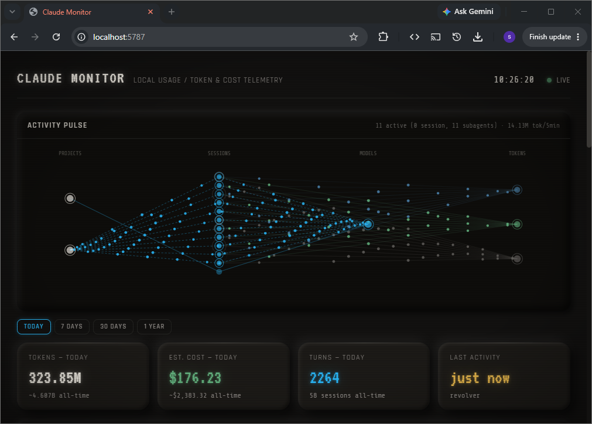

# Claude Monitor



A local dashboard for [Claude Code](https://claude.com/product/claude-code) token usage and cost. It reads the JSONL transcripts and stats files Claude Code already keeps under `~/.claude` on your machine, aggregates them, and serves a live dashboard — turns, tokens, estimated cost, per-project and per-model breakdowns, and a real-time "activity pulse" view of sessions/subagents as they run.

All usage data stays local — read-only, localhost-only, nothing about your usage is ever uploaded anywhere. The one outbound network call is a Google Fonts import for the display type (`public/index.html`); see [How it works](#how-it-works) if you want to swap that out or remove it.

## Requirements

- Node.js ≥ 18.11
- Claude Code, run at least once, so `~/.claude/projects` exists

## Install & run

```sh
git clone <this-repo-url>
cd claude-monitor
npm install
npm run dev
```

Then open **http://127.0.0.1:5787**.

- `npm run dev` — starts the server with `node --watch`, auto-restarting on server-file changes (recommended for local use)
- `npm start` — starts the server once, no auto-restart
- `npm run stop` — kills whatever's listening on the port, in case a previous run is still bound to it

The port defaults to `5787`; override with `PORT=<port> npm run dev`.

## How it works

- **Read-only.** The server only ever reads (`readFileSync`/`readdirSync`/`statSync`, and `openSync(path, 'r')`/`readSync` to read large transcripts in slices) — no file is ever written, renamed, or deleted. It reads your `~/.claude` directory and, from `~/.claude.json` (plus Claude Code's own backups of it), only each project's `lastSessionId` and `lastModelUsage`. It never reads message content, only timestamps, token counts, model IDs, and project directory names.
- **Localhost only.** The server binds to `127.0.0.1`, not `0.0.0.0` — it's not reachable from your LAN.
- **No hardcoded paths.** The `~/.claude` location is resolved at runtime via Node's `os.homedir()`, so this works the same on Windows, macOS, and Linux, under any username.
- **Fonts are modular.** The two `<link>` tags at the top of `public/index.html` pull the default type (VT323, Share Tech Mono, Rajdhani) from Google Fonts — swap them for your own Google Fonts import, or delete them entirely. Either way, `public/style.css`'s `--font-*-custom` variables in `:root` are the one thing to edit to match, and every font-family already falls back to a full system-font stack if nothing loads.
- Cost is computed from a local pricing table (`server/pricing.js`) and may drift if Anthropic changes pricing — check `platform.claude.com/docs/en/about-claude/pricing` if numbers look stale (last verified 2026-11-11).

## How costs are computed

Everything is priced at Claude API list prices, at the price of the model actually used at the time. Each total is labeled by how it was derived:

- **Exact.** Every API response logged in a transcript, counted once (Claude Code writes several transcript lines per response, each repeating its usage), including subagents. Where Claude Code's own running cost record (`cost-state` lines) shows usage the transcript missed — responses whose final usage was never written, background helper calls — the difference is added back. (Most transcript totals match those records to the token.)
- **Recovered.** Sessions whose transcripts were deleted but that Claude Code itself recorded (`~/.claude.json`, `stats-cache.json`), spread over those sessions' prompts.
- **~Estimated.** Prompts in `history.jsonl` with no surviving usage data at all. Each is estimated from your own sessions: its position in its session (later prompts re-read more context), its project's measured intensity, how heavily you were using Claude Code around that date, and the models you were using then. The dashboard shows the plausible range alongside the estimate. Also estimated: a small correction for logged responses no cost record covers, fitted on the ones it does.

Claude Code's own `/cost` can differ for Sonnet 5: it still prices it at $3/$15, a price increase Anthropic cancelled before it took effect ($2/$10 is the actual price).

## License

MIT — see [LICENSE](./LICENSE).
